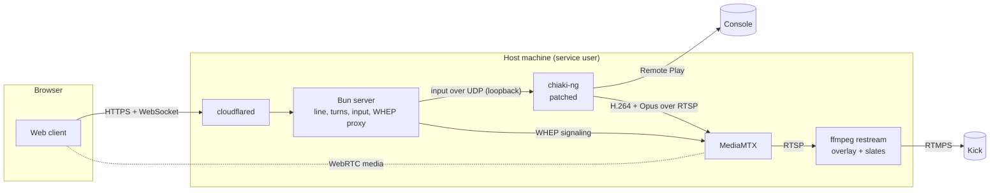

<h1 align="center">PlayGTA</h1>

<p align="center">
  <strong>Let strangers take turns playing your console from their browser.</strong><br>
  <sub>by <a href="https://gtalab.dev">gtalab</a></sub>
</p>

<p align="center">
  <a href="#the-story">The story</a> ·
  <a href="#how-it-works">How it works</a> ·
  <a href="#get-started">Get started</a> ·
  <a href="docs/setup.md">Setup guide</a> ·
  <a href="docs/setup.md#set-it-up-with-an-ai-agent">Set up with an AI agent</a> ·
  <a href="#configuration">Configuration</a> ·
  <a href="#security-model">Security</a> ·
  <a href="#support">Support</a> ·
  <a href="#disclaimer">Disclaimer</a>
</p>

PlayGTA puts your PlayStation online behind a first-come line. Visitors open a web page and join the line. When their turn comes, the controller is theirs: they see the console in real time and play with their keyboard or gamepad. Everyone else watches the live stream on Kick.

It works with any game your console can stream over Remote Play. A few things are tuned for GTA VI, like the default keyboard and mouse controls; `KEYBOARD_LAYOUT=generic` switches to a plain button layout for other games.

We built it the weekend GTA VI came out, so anyone could try it on our PS5 straight from their browser. The launch post passed 750K views, the stream peaked at ~330 viewers, and the line ran into the hundreds. This is the code behind it, cleaned up and open.

### What's inside

| Part             | What it does                                                                                                                                |
| ---------------- | ------------------------------------------------------------------------------------------------------------------------------------------- |
| **Server**       | Bun + TypeScript. Runs the line and turns, Kick login, and survives restarts without losing the line.                                       |
| **Console link** | A patched [chiaki-ng](https://github.com/streetpea/chiaki-ng) Remote Play client and MediaMTX, so the player gets low-latency WebRTC video. |
| **Stream**       | An ffmpeg restream to Kick with a live overlay of who is playing and who is next.                                                           |
| **Isolation**    | A macOS kit with a separate user, sandboxing and a firewall, so visitors never get near the rest of your machine.                           |

> [!IMPORTANT]
> PlayGTA is an experiment for learning and for playing with friends on your own console. **Do not run it as a commercial service.** Selling access or turns breaks the terms of your console, your account and your games. See the [disclaimer](#disclaimer).

## The story

One weekend we let strangers play GTA VI on our PS5 from their browser, live on Kick. You joined a line, and when your turn came, the controller was yours.

<p align="center">
  <a href="https://x.com/germanfndezz/status/2124545599941103855"></a>
  <br>
  <sub><a href="https://x.com/germanfndezz/status/2124545599941103855">Watch the launch video on X</a></sub>
</p>

<p align="center">
  <a href="https://x.com/germanfndezz/status/2124545599941103855"></a>
</p>

### What happened

The line exploded. The launch post took off, the Kick restream peaked at ~330 viewers, and Kick approved the channel for the Kick Partner Program. Far more people showed up than one console could serve, so turns got short and waits got long. We kept shipping through the weekend: tip-to-skip let someone jump ahead, a donation goal on the stream showed everyone how close we were to the next milestone, and the restream picked up an overlay with the line, the current player and a few slates for standby and outages.

Even Kick showed up in the replies:

<p align="center"><a href="https://x.com/kick/status/2124658544792551441"></a></p>

Some of our favorite replies:

<table>
  <tr>
    <td><a href="https://x.com/Freedom_Trinity/status/2124591080767361201"></a></td>
    <td><a href="https://x.com/abady1245/status/2124582911600935006"></a></td>
  </tr>
  <tr>
    <td><a href="https://x.com/tamerica_94/status/2124601313489309698"></a></td>
    <td><a href="https://x.com/WamiiEdits/status/2124649357450563698"></a></td>
  </tr>
  <tr>
    <td colspan="2" align="center"><a href="https://x.com/yeabu369/status/2124581372488466886"></a></td>
  </tr>
  <tr>
    <td colspan="2" align="center"><a href="https://x.com/AfnadX/status/2124560304038420529"></a></td>
  </tr>
</table>

Someone suggested tipping to skip the line, so we built it that night. (Tips and the donation goal are not part of this open-source version: PlayGTA is for playing with friends, not for making money.)

### Why we paused

It got way bigger than we expected. Handing a console and an account to the whole internet sits badly with the terms of the console maker, the game and the streaming platform. On top of that, running it properly would have been a full-time job, and this was a weekend project. So we switched it off before it turned into a problem.

Still, it was a great experience, and we're pretty sure more than a few people had an amazing time.

<p align="center">
  <a href="https://x.com/germanfndezz/status/2124672596361027742"></a>
</p>

### Why we open-sourced it

The most common question in the replies:

<table>
  <tr>
    <td><a href="https://x.com/HarshitKhemani/status/2124680818543165768"></a></td>
    <td><a href="https://x.com/Jaxstyle1337/status/2124625853082435884"></a></td>
  </tr>
</table>

Now it is. The fun part was never our PS5. It was the plumbing: a fair line, low-latency input from a browser tab, WebRTC video and a restream that keeps up. That is reusable, so here it is. Run it with friends, on your own console, and read the [disclaimer](#disclaimer) first.

## How it works

Visitors join a line. The player at the front controls the console with a gamepad or the keyboard, sees low-latency WebRTC video and gets a timed turn; idle players lose it. Everyone else watches the restream.



- **Line and turns**: first come, first served, one place per visitor (or per Kick account), timed turns with an idle kick.
- **Input relay**: browser input travels as 15-byte binary frames; only the controller's reach the console, and system buttons are blocked.
- **Video**: the server's WHEP proxy decides who may watch directly; the controller always can.
- **Bring your own UI**: the bundled page in `public/` is a small reference client. The WebSocket messages, input encoding and admin API are documented in [docs/protocol.md](docs/protocol.md).
- **Optional**: Kick login, a Kick restream with an overlay and standby, outage and paused slates, line persistence, a local-only admin API with a CLI (`bun run admin`) and a paused mode.
- **Console backends**: a built-in simulator, or a patched [chiaki-ng](https://github.com/streetpea/chiaki-ng) for PlayStation Remote Play (`chiaki/`, AGPL-3.0).

More in [docs/architecture.md](docs/architecture.md) and [docs/streaming.md](docs/streaming.md).

## Get started

There are three ways in, from a 30-second look to a full setup.

### 1. Try it in 30 seconds

No console needed. Requires [Bun](https://bun.sh) 1.4 or newer (`brew install oven-sh/bun/bun`); Bun runs the TypeScript directly, so there is no build step.

```bash
bun install
bun start
```

Open http://localhost:3000, join the line and drive the simulated console with the keyboard, the mouse or a gamepad.

### 2. Set up your own console

The **[setup guide](docs/setup.md)** goes from a new Mac and a PS5 to friends playing from their browsers. Every stage ends with a check, so a problem shows up where it starts:

1. [Try the simulated console](docs/setup.md#2-try-it-with-the-simulated-console)
2. [Prepare the PS5](docs/setup.md#3-prepare-the-ps5) and [build chiaki-ng and MediaMTX](docs/setup.md#4-build-chiaki-ng-and-mediamtx)
3. [Link the console](docs/setup.md#5-register-the-console-in-chiaki-ng) and [play it yourself on localhost](docs/setup.md#6-play-it-yourself-on-localhost)
4. [Put it online for friends](docs/setup.md#7-put-it-online-for-friends)
5. Optional: [Kick login, restream and admin](docs/setup.md#8-optional-extras), and an [always-on, isolated host](docs/setup.md#9-an-always-on-isolated-host)

Stuck? See [troubleshooting](docs/setup.md#11-troubleshooting).

### 3. Let your AI agent set it up

Clone the repository, open Claude Code, Codex or any coding agent in it, and paste the prompt from **[Set it up with an AI agent](docs/setup.md#set-it-up-with-an-ai-agent)**. The agent follows the guide stage by stage and checks each one. You only do what has to be you: the PS5 settings, linking the console and your accounts. Agents also get project rules in [AGENTS.md](AGENTS.md).

### Controls

The default keyboard and mouse controls follow GTA's PC layout: WASD to move, the mouse to look, right click to aim, left click to shoot, and G to switch W and S to gas and brake while driving. Any gamepad works too. The full table is in the [setup guide](docs/setup.md#10-controls), and `KEYBOARD_LAYOUT=generic` switches to a plain button layout for other games.

### Managing the line

Start the server with `ADMIN_TOKEN=change-me-to-something-long bun start`. In another terminal with the same `ADMIN_TOKEN`, run `bun run admin status` (also `skip`, `pause`, `resume` and `kick <id>`; `bun run admin help` lists them, and `--json` prints raw output).

## Configuration

Environment variables, or a `.env` file (see `.env.example`). Invalid values stop the server with every problem listed.

| Variable                               | Default             | Purpose                                                                |
| -------------------------------------- | ------------------- | ---------------------------------------------------------------------- |
| `PORT`, `HOST`                         | `3000`, `127.0.0.1` | Where the server listens. Put a tunnel in front.                       |
| `PUBLIC_URL`, `TRUSTED_PROXY`          | unset, `none`       | The public HTTPS address, and `cloudflare` behind a Cloudflare Tunnel. |
| `TURN_MINUTES`, `IDLE_TURN_SECONDS`    | `10`, `20`          | Turn length, and idle time before the turn is lost.                    |
| `CONSOLE`, `VIDEO`, `CONSOLE_HOST`     | `simulated`, `off`  | `chiaki` and `webrtc` for a real console at that IP.                   |
| `ADMIN_TOKEN`                          |                     | Turns on the local-only admin API (`bun run admin`).                   |
| `KICK_CLIENT_ID`, `KICK_CLIENT_SECRET` |                     | Require "Log in with Kick" to join.                                    |
| `KEYBOARD_LAYOUT`                      | `gta`               | Keyboard and mouse controls: `gta`, or `generic` for any game.         |
| `PAUSED`                               | `off`               | Show only the paused page.                                             |

Everything else: [docs/configuration.md](docs/configuration.md).

## Security model

- **Nothing public by default.** The server binds to loopback; only a tunnel exposes it.
- **The admin API does not exist from the internet.** It answers only to direct loopback requests without proxy headers, plus a bearer token. On a public site it requires `TRUSTED_PROXY=cloudflare`.
- **Untrusted input everywhere.** Controller state is clamped, SDP offers keep only public and mDNS candidates, and requests, messages and sockets are rate-limited and capped.
- **Least data.** Resume tokens and logins are stored as hashes.
- **Isolation on the host.** The macOS kit runs everything as a standard user, with Seatbelt profiles and a pf anchor that blocks the LAN except the console.

Details and known limits: [docs/security.md](docs/security.md). To report a vulnerability, see [SECURITY.md](SECURITY.md).

## Support

PlayGTA is free and open source. If you'd like to support its development:

- **Ko-fi:** [ko-fi.com/germancito](https://ko-fi.com/germancito)
- **Solana:** `9ZiuVZJQ72P6bhPuAYzhWWMzreHGs3WQfJqNpUGFMfEo`

Donations are voluntary and give you nothing in return.

## Disclaimer

PlayGTA is an independent project. It is not affiliated with, endorsed by or sponsored by Sony Interactive Entertainment, PlayStation, Rockstar Games, Take-Two Interactive, or any other game publisher or platform. Grand Theft Auto and GTA VI are trademarks of Take-Two Interactive. All trademarks belong to their owners. Screenshots, video and other media of third-party games in this repository belong to their respective owners and appear here only to document the project.

Sharing control of a console or account, using Remote Play this way, or broadcasting gameplay may break the terms of your console maker, your online account, the game's publisher or the streaming platform, and can get accounts suspended. You are responsible for following the terms of your platform and your games, and for what visitors do with your console.

**PlayGTA is not meant to be commercialized.** Do not use it to sell access to a console, a game or an account, to sell turns, or to run a paid "console rental" or cloud gaming service. Game licenses and console accounts are personal and non-commercial, and that use is not permitted by the platforms and publishers involved. The software is provided as is, without warranty, and the authors take no responsibility for how it is used.

## License

MIT, by gtalab, except `chiaki/` (AGPL-3.0, derived from chiaki-ng) and the bundled fonts (SIL OFL 1.1). See [LICENSE](LICENSE) and [THIRD_PARTY_NOTICES.md](THIRD_PARTY_NOTICES.md).
